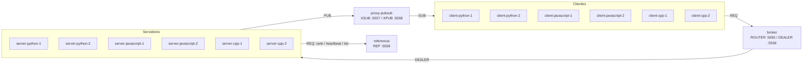

# Projeto CCM140: sistema de troca de mensagens instantâneas

Projeto da disciplina de Sistemas Distribuídos. É uma versão simplificada de um sistema no estilo BBS/IRC: bots (clientes) fazem login, criam canais, se inscrevem em canais e publicam mensagens, e os servidores guardam em disco todas as interações.

Toda a comunicação usa **ZeroMQ** e todo o sistema roda em **containers Docker** orquestrados pelo **Docker Compose**. Nenhum passo depende de interação humana: os usuários são bots.

Desde a parte 3, todas as mensagens levam um **relógio lógico**, e um **serviço de referência** controla quais servidores estão ativos (rank e heartbeat) e fornece a hora correta para sincronizar o relógio físico dos servidores.

## Integrantes e linguagens

O grupo tem 3 integrantes, então são 3 linguagens. Cada linguagem implementa o cliente, o servidor, o broker e o proxy, e todos conversam entre si. O serviço de referência foi implementado em C++ e em JavaScript.

| Integrante | Linguagem |
|---|---|
| Vinicius Nobre | C++ |
| Gabriel Engle | JavaScript (Node.js) |
| Breno Queiroga| Python |

Por que essas linguagens:
- **Python**: tem bibliotecas maduras para ZeroMQ (`pyzmq`) e MessagePack (`msgpack`), e o código fica curto e fácil de ler.
- **JavaScript (Node.js)**: tem um modelo assíncrono que combina com sockets (`zeromq` v6 com `async/await`), usando `msgpack5`.
- **C++17**: é compilado, usa `cppzmq` e `msgpack-cxx`, e mostra a interoperabilidade com uma linguagem de mais baixo nível.

## Como executar

```bash
cd source
docker compose up --build
```

Para começar com os dados zerados (apaga os volumes dos servidores):

```bash
cd source
docker compose down -v
docker compose up --build
```

## Arquitetura



O compose sobe 15 containers:

| Serviço | Imagem/linguagem | Função |
|---|---|---|
| `broker` | C++ | Proxy Req-Rep. Os clientes se conectam no ROUTER (5555) e os servidores no DEALER (5556). O DEALER distribui as requisições entre os servidores em round-robin. |
| `proxy-pubsub` | JavaScript | Proxy Pub/Sub. Os servidores publicam no XSUB (5557) e os clientes assinam no XPUB (5558). |
| `referencia` | C++ | Serviço de referência (porta 5559). Conversa só com os servidores: dá o rank, mantém a lista de servidores ativos por heartbeat e informa a hora correta. |
| `server-{python,javascript,cpp}-{1,2}` | as 3 linguagens | 2 servidores por linguagem. Cada um tem o seu próprio volume de dados. |
| `client-{python,javascript,cpp}-{1,2}` | as 3 linguagens | 2 bots por linguagem. |

O broker e o proxy foram implementados nas três linguagens (`broker.py/js/cpp`, `proxy_pubsub.py/js/cpp`), e a referência em C++ e JavaScript (`referencia.cpp`, `reference.js`). Como só uma instância de cada é necessária, o compose usa o broker em C++, o proxy em JavaScript e a referência em C++. As outras versões seguem o mesmo protocolo e podem substituí-las trocando o `build`/`command` do serviço.

Cada servidor recebe no compose as variáveis `SERVER_NAME` (o nome usado na referência, por exemplo `server-cpp-1`) e `REFERENCE_ENDPOINT` (`tcp://referencia:5559`).

Como o broker distribui as requisições em round-robin, as requisições consecutivas de um mesmo bot podem ser atendidas por servidores de linguagens diferentes. Isso garante que todo servidor atenda clientes de todas as linguagens.

## Formato das mensagens

- **Serialização:** todas as mensagens são serializadas em binário com **MessagePack** (nenhuma mensagem trafega como JSON, XML ou texto simples).
- **Estrutura:** cada mensagem é um mapa. Os valores são textos, com três exceções: `logical_clock` é um número inteiro, e nas respostas da referência `rank` também é um número e `servers` é uma lista de `{ name, rank }`. O C++ converte qualquer valor recebido para texto antes de usá-lo, então aceita todos esses formatos.
- **Timestamp:** toda mensagem (requisição, resposta e publicação) tem o campo `timestamp` com o horário de envio.
- **Relógio lógico:** toda mensagem tem o campo `logical_clock` com o relógio lógico de quem envia (ver [Relógios e heartbeat](#relógios-e-heartbeat-parte-3)).

A especificação completa (campos de cada ação, respostas e erros) está em [`source/protocol/protocol.md`](source/protocol/protocol.md).

Resumo das ações Req-Rep:

| `action` | Campos enviados | Resposta de sucesso |
|---|---|---|
| `login` | `username` | `status: success`, `message` |
| `list_channels` | (nenhum) | `status: success`, `channels` (nomes separados por `;`) |
| `create_channel` | `channel` | `status: success`, `message` |
| `publish` | `channel`, `message`, `username` | `status: success`, `message` |

Em caso de erro, a resposta tem `status: error` e o motivo no campo `message`.

## Publicação em canais (Pub/Sub)

1. O bot envia `publish` ao broker, que encaminha a requisição para algum servidor.
2. O servidor salva a publicação em disco e publica no proxy uma mensagem com **2 frames**:
   - frame 1: o **nome do canal** (o tópico do Pub/Sub);
   - frame 2: a publicação em MessagePack: `channel`, `message`, `username`, `timestamp` (horário da publicação) e `logical_clock`.
3. O servidor responde ao bot com `OK` ou com o erro.
4. Cada bot tem **uma única conexão SUB** com o proxy, onde assina vários canais. Ao receber uma publicação, o bot mostra o canal, o autor, a mensagem, o horário de envio, o horário de recebimento e o relógio lógico.

Como o filtro de tópicos do ZeroMQ é por prefixo (assinar `canal-a` também recebe `canal-ab`), os clientes descartam as publicações cujo tópico não é exatamente um canal assinado.

**Canais e vários servidores:** cada servidor guarda a sua própria lista de canais. Como o broker distribui as requisições, um canal pode ser criado num servidor e receber publicações por outro. Nesse caso o servidor que recebeu o `publish` registra o canal na sua lista e publica normalmente. A replicação completa dos dados entre os servidores fica para a parte 5 do projeto.

## Comportamento dos bots

Ao iniciar, o bot faz login (e repete o login em caso de erro). Depois fica em loop infinito:

1. pede a lista de canais e, se houver menos de 5, cria um canal novo (`canal-<BOT>-<epoch em ms>`);
2. se estiver inscrito em menos de 3 canais, se inscreve em mais um, sorteado entre os que ainda não assina;
3. sorteia um canal da lista e envia 10 mensagens aleatórias, com 1 segundo de intervalo entre elas.

Cliente e servidor imprimem na tela todas as mensagens enviadas e recebidas, com o conteúdo completo:
- **cliente:** `[REQ]` e `[REP]` para as requisições, e um bloco `NOVA MENSAGEM` para cada publicação recebida, que inclui o relógio lógico da publicação e o relógio local depois de recebê-la;
- **servidor:** `[RECEBIDO]` e `[ENVIADO]` para cada requisição, `[PUB]` para cada publicação e as mensagens trocadas com a referência (`[REQ REFERÊNCIA]`/`[REP REFERÊNCIA]` no C++, `[REF-REQ]`/`[REF-REP]` no Python).

## Relógios e heartbeat (parte 3)

### Relógio lógico

Clientes, servidores e a referência mantêm um contador (relógio de Lamport) que começa em 0 junto com o processo:

1. **antes de enviar** qualquer mensagem, o processo soma 1 ao contador e envia o valor no campo `logical_clock`;
2. **ao receber** uma mensagem, o processo fica com o maior valor entre o seu contador e o `logical_clock` recebido.

Isso vale para requisições, respostas, publicações e as mensagens entre servidores e referência. Nos clientes C++ e Python, a thread principal e a thread do SUB usam o mesmo contador, protegido por um mutex/lock.

Exemplo de uma publicação: o bot envia o `publish` com `logical_clock: 92`; o servidor fica com 92, publica com 93 e responde com 94; quem recebe a publicação mostra `Relógio lógico: 93` e passa a ter pelo menos 93.

### Serviço de referência

O serviço `referencia` (porta 5559, `REQ`/`REP`) só recebe mensagens dos servidores:

| `action` | Enviado pelo servidor | Resposta |
|---|---|---|
| `rank` | `name` | `status: success` e `rank`. O mesmo nome recebe sempre o mesmo rank, então não há repetição. |
| `heartbeat` | `name` | `status: success`, `message: OK` e `rank`. Se o servidor nunca pediu rank, responde `status: error` com `Servidor não registrado`. |
| `list` | `name` | `status: success` e `servers`, a lista de `{ name, rank }` dos servidores disponíveis, ordenada pelo rank. |

Toda resposta da referência leva também o `timestamp` com a **hora correta**, no formato ISO 8601 UTC com milissegundos (por exemplo `2026-11-15T19:07:34.856Z`), e o `logical_clock`.

**Remoção de servidores:** a referência guarda o horário do último rank/heartbeat de cada servidor. Se um servidor passa mais de 30 segundos sem mandar heartbeat (configurável com `HEARTBEAT_TIMEOUT_MS`), ele é removido da lista de disponíveis e aparece `[REMOVIDO]` no log. Quando ele volta a se comunicar, retorna à lista com o mesmo rank.

### Rank e heartbeat nos servidores

- **Ao iniciar**, o servidor pede o seu rank à referência.
- **A cada 10 mensagens de clientes recebidas**, o servidor manda um heartbeat. O servidor C++ também pede a lista de servidores depois do heartbeat e a mostra no log (`[SERVIDORES]`).
- **Se a referência responder `Servidor não registrado`** (por exemplo, porque ela reiniciou), o servidor pede o rank de novo.
- **Se a referência não responder** dentro de 2 segundos, o servidor registra o erro e continua atendendo os clientes, em vez de travar.

### Sincronização do relógio físico

Cada servidor guarda uma diferença (em ms) entre o seu relógio e o relógio do sistema. Todos os timestamps que o servidor gera usam o relógio já corrigido. A correção usa a hora da resposta da referência:

- **C++ e Python** usam o algoritmo de Cristian: a hora correta estimada é a hora da referência mais metade do tempo de ida e volta da mensagem. O ajuste é feito a cada heartbeat (no Python, também na resposta do rank) e aparece no log como `[RELÓGIO] Ajuste de X ms`.
- **JavaScript** usa a hora da referência diretamente, a cada resposta recebida dela.

Como todos os containers usam o relógio da mesma máquina, os ajustes normalmente ficam entre −2 e +2 ms. Para ver a sincronização corrigindo um relógio atrasado, os servidores C++ e Python aceitam a variável `CLOCK_OFFSET_MS`: com `CLOCK_OFFSET_MS: "4000"` no `environment` de um servidor, ele começa 4 segundos adiantado e o primeiro heartbeat corrige essa diferença.

### Como verificar

Com os containers rodando, num segundo terminal (em `source/`):

```bash
# rank, ajustes de relógio e lista de servidores de um servidor C++
docker compose logs server-cpp-1 | grep -E "RANK|RELÓGIO|SERVIDORES"

# remoção por falta de heartbeat: pare um servidor e espere uns 40 segundos
docker compose stop server-cpp-2
docker compose logs referencia | grep REMOVIDO

# ao religar, o servidor recebe o mesmo rank
docker compose start server-cpp-2
docker compose logs server-cpp-2 | grep RANK
```

## Persistência

Cada servidor tem o seu próprio conjunto de dados, num volume Docker separado (`/app/data`). Os arquivos não são compartilhados entre os servidores. São armazenados:

- **Logins:** usuário e timestamp de cada login, em `users.txt` (`usuario,timestamp`).
- **Canais:** um canal por linha, em `channels.txt`.
- **Publicações:**
  - **Python e JavaScript:** `events.jsonl`, um evento por linha. Ficam salvos todas as requisições recebidas (`request`), todas as respostas enviadas (`response`), as publicações (`publication`, com canal, mensagem, autor, timestamp da publicação e timestamp da requisição) e, no JS, também a criação de canais (`channel_created`). Isso permite reconstruir todo o histórico de interações.
  - **C++:** `messages.txt`, uma publicação por linha, no formato `canal|usuario|mensagem|timestamp_requisicao|timestamp_publicacao`.

Os formatos de armazenamento são livres (a restrição de não usar JSON vale só para as mensagens trocadas pela rede). Escolhemos arquivos de texto em modo *append* porque são simples, legíveis e não perdem dados anteriores quando o container reinicia.

## Estrutura do repositório

```
source/
├── docker-compose.yml
├── protocol/protocol.md   # especificação das mensagens
├── python/                # client.py, server.py, broker.py, proxy_pubsub.py, Dockerfile
├── javascript/            # client.js, server.js, broker.js, proxy_pubsub.js, reference.js, Dockerfile
└── cpp/                   # client.cpp, server.cpp, broker.cpp, proxy_pubsub.cpp, referencia.cpp, CMakeLists.txt, Dockerfile
_etapas-do-projeto/        # enunciado e partes do projeto
```
