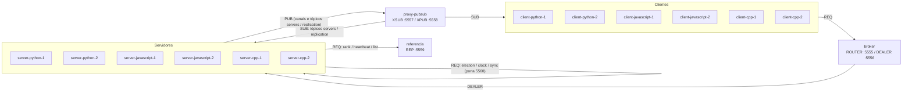

# Projeto CCM140: sistema de troca de mensagens instantâneas

Projeto da disciplina de Sistemas Distribuídos. É uma versão simplificada de um sistema no estilo BBS/IRC: bots (clientes) fazem login, criam canais, se inscrevem em canais e publicam mensagens, e os servidores guardam em disco todas as interações.

Toda a comunicação usa **ZeroMQ** e todo o sistema roda em **containers Docker** orquestrados pelo **Docker Compose**. Nenhum passo depende de interação humana: os usuários são bots.

Desde a parte 3, todas as mensagens levam um **relógio lógico**, e um **serviço de referência** controla quais servidores estão ativos (rank e heartbeat). Desde a parte 4, os servidores **elegem um coordenador** entre si, e é ele que fornece a hora correta para sincronizar o relógio físico dos outros servidores (algoritmo de Berkeley). Na parte 5, os servidores **replicam os dados** entre si pelo Pub/Sub, para que qualquer servidor tenha o histórico completo.

## Integrantes e linguagens

O grupo tem 3 integrantes, então são 3 linguagens. Cada linguagem implementa o cliente, o servidor, o broker, o proxy e o serviço de referência, e todos conversam entre si.

| Integrante | Linguagem |
|---|---|
| Vinicius Nobre | C++ |
| Gabriel Engle | JavaScript (Node.js) |
| Breno Queiroga| Python |

Por que essas linguagens:
- **Python**: tem bibliotecas maduras para ZeroMQ (`pyzmq`) e MessagePack (`msgpack`), e o código fica curto e fácil de ler.
- **JavaScript (Node.js)**: tem um modelo assíncrono que combina com sockets (`zeromq` v6 com `async/await`), usando `msgpack5`.
- **C++17**: é compilado, usa `cppzmq` e `msgpack-cxx`, e mostra a interoperabilidade com uma linguagem de mais baixo nível.

## Como executar

```bash
cd source
docker compose up --build
```

Para começar com os dados zerados (apaga os volumes dos servidores):

```bash
cd source
docker compose down -v
docker compose up --build
```

## Arquitetura



O compose sobe 15 containers:

| Serviço | Imagem/linguagem | Função |
|---|---|---|
| `broker` | C++ | Proxy Req-Rep. Os clientes se conectam no ROUTER (5555) e os servidores no DEALER (5556). O DEALER distribui as requisições entre os servidores em round-robin. |
| `proxy-pubsub` | JavaScript | Proxy Pub/Sub. Os servidores publicam no XSUB (5557) e os clientes assinam no XPUB (5558). |
| `referencia` | C++ | Serviço de referência (porta 5559). Conversa só com os servidores: dá o rank e mantém a lista de servidores ativos por heartbeat. |
| `server-{python,javascript,cpp}-{1,2}` | as 3 linguagens | 2 servidores por linguagem. Cada um tem o seu próprio volume de dados e atende os outros servidores (eleição, relógio e sincronização de dados) na porta 5560. |
| `client-{python,javascript,cpp}-{1,2}` | as 3 linguagens | 2 bots por linguagem. |

O broker, o proxy e a referência foram implementados nas três linguagens (`broker.py/js/cpp`, `proxy_pubsub.py/js/cpp`, `reference.py`/`reference.js`/`referencia.cpp`). Como só uma instância de cada é necessária, o compose usa o broker em C++, o proxy em JavaScript e a referência em C++. As outras versões seguem o mesmo protocolo e podem substituí-las trocando o `build`/`command` do serviço.

Cada servidor recebe no compose as variáveis `SERVER_NAME` (o nome usado na referência e na eleição, por exemplo `server-cpp-1`, que também é o nome do container na rede), `REFERENCE_ENDPOINT` (`tcp://referencia:5559`) e `PEER_PORT`/`PEER_BIND_ENDPOINT` (a porta 5560, usada na comunicação entre servidores).

Como o broker distribui as requisições em round-robin, as requisições consecutivas de um mesmo bot podem ser atendidas por servidores de linguagens diferentes. Isso garante que todo servidor atenda clientes de todas as linguagens.

## Formato das mensagens

- **Serialização:** todas as mensagens são serializadas em binário com **MessagePack** (nenhuma mensagem trafega como JSON, XML ou texto simples).
- **Estrutura:** cada mensagem é um mapa. Os valores são textos, com três exceções: `logical_clock` é um número inteiro, e nas respostas da referência `rank` também é um número e `servers` é uma lista de `{ name, rank }`. O C++ converte qualquer valor recebido para texto antes de usá-lo, então aceita todos esses formatos.
- **Timestamp:** toda mensagem (requisição, resposta e publicação) tem o campo `timestamp` com o horário de envio.
- **Relógio lógico:** toda mensagem tem o campo `logical_clock` com o relógio lógico de quem envia (ver [Relógios e heartbeat](#relógios-e-heartbeat-parte-3)).

A especificação completa (campos de cada ação, respostas e erros) está em [`source/protocol/protocol.md`](source/protocol/protocol.md).

Resumo das ações Req-Rep:

| `action` | Campos enviados | Resposta de sucesso |
|---|---|---|
| `login` | `username` | `status: success`, `message` |
| `list_channels` | (nenhum) | `status: success`, `channels` (nomes separados por `;`) |
| `create_channel` | `channel` | `status: success`, `message` |
| `publish` | `channel`, `message`, `username` | `status: success`, `message` |

Em caso de erro, a resposta tem `status: error` e o motivo no campo `message`.

## Publicação em canais (Pub/Sub)

1. O bot envia `publish` ao broker, que encaminha a requisição para algum servidor.
2. O servidor salva a publicação em disco e publica no proxy uma mensagem com **2 frames**:
   - frame 1: o **nome do canal** (o tópico do Pub/Sub);
   - frame 2: a publicação em MessagePack: `channel`, `message`, `username`, `timestamp` (horário da publicação) e `logical_clock`.
3. O servidor responde ao bot com `OK` ou com o erro.
4. Cada bot tem **uma única conexão SUB** com o proxy, onde assina vários canais. Ao receber uma publicação, o bot mostra o canal, o autor, a mensagem, o horário de envio, o horário de recebimento e o relógio lógico.

Como o filtro de tópicos do ZeroMQ é por prefixo (assinar `canal-a` também recebe `canal-ab`), os clientes descartam as publicações cujo tópico não é exatamente um canal assinado.

**Canais e vários servidores:** cada servidor guarda a sua própria lista de canais. Como o broker distribui as requisições, um canal pode ser criado num servidor e receber publicações por outro. Nesse caso o servidor que recebeu o `publish` registra o canal na sua lista e publica normalmente. Desde a parte 5, a criação do canal também é replicada para os outros servidores (ver [Replicação](#replicação-parte-5)).

## Comportamento dos bots

Ao iniciar, o bot faz login (e repete o login em caso de erro). Depois fica em loop infinito:

1. pede a lista de canais e, se houver menos de 5, cria um canal novo (`canal-<BOT>-<epoch em ms>`);
2. se estiver inscrito em menos de 3 canais, se inscreve em mais um, sorteado entre os que ainda não assina;
3. sorteia um canal da lista e envia 10 mensagens aleatórias, com 1 segundo de intervalo entre elas.

Cliente e servidor imprimem na tela todas as mensagens enviadas e recebidas, com o conteúdo completo:
- **cliente:** `[REQ]` e `[REP]` para as requisições, e um bloco `NOVA MENSAGEM` para cada publicação recebida, que inclui o relógio lógico da publicação e o relógio local depois de recebê-la;
- **servidor:** `[RECEBIDO]` e `[ENVIADO]` para cada requisição, `[PUB]` para cada publicação, as mensagens trocadas com a referência (`[REQ REFERÊNCIA]`/`[REP REFERÊNCIA]` no C++, `[REF-REQ]`/`[REF-REP]` no Python) e as trocadas com outros servidores (`[REQ SERVIDOR]`/`[REP SERVIDOR]`/`[RECEBIDO SERVIDOR]`/`[ENVIADO SERVIDOR]` no C++, `[PEER-...]` no Python), além de `[ELEIÇÃO]`, `[COORDENADOR]` e `[RELÓGIO]`.

## Relógios e heartbeat (parte 3)

### Relógio lógico

Clientes, servidores e a referência mantêm um contador (relógio de Lamport) que começa em 0 junto com o processo:

1. **antes de enviar** qualquer mensagem, o processo soma 1 ao contador e envia o valor no campo `logical_clock`;
2. **ao receber** uma mensagem, o processo fica com o maior valor entre o seu contador e o `logical_clock` recebido.

Isso vale para requisições, respostas, publicações e as mensagens entre servidores e referência. Nos clientes C++ e Python, a thread principal e a thread do SUB usam o mesmo contador, protegido por um mutex/lock.

Exemplo de uma publicação: o bot envia o `publish` com `logical_clock: 92`; o servidor fica com 92, publica com 93 e responde com 94; quem recebe a publicação mostra `Relógio lógico: 93` e passa a ter pelo menos 93.

### Serviço de referência

O serviço `referencia` (porta 5559, `REQ`/`REP`) só recebe mensagens dos servidores:

| `action` | Enviado pelo servidor | Resposta |
|---|---|---|
| `rank` | `name` | `status: success` e `rank`. O mesmo nome recebe sempre o mesmo rank, então não há repetição. |
| `heartbeat` | `name` | `status: success` e `message: OK`. Se o servidor nunca pediu rank, responde `status: error` com `Servidor não registrado`. |
| `list` | `name` | `status: success` e `servers`, a lista de `{ name, rank }` dos servidores disponíveis, ordenada pelo rank. |

Toda resposta da referência leva também o `timestamp` de envio e o `logical_clock`, como qualquer mensagem. Na parte 3 esse `timestamp` era a hora correta usada pelos servidores; **desde a parte 4 a referência não fornece mais a hora** (o heartbeat responde só `OK`), e a hora correta vem do coordenador eleito (ver [Eleição e sincronização](#eleição-e-sincronização-parte-4)).

**Remoção de servidores:** a referência guarda o horário do último rank/heartbeat de cada servidor. Se um servidor passa mais de 30 segundos sem mandar heartbeat (configurável com `HEARTBEAT_TIMEOUT_MS`), ele é removido da lista de disponíveis e aparece `[REMOVIDO]` no log. Quando ele volta a se comunicar, retorna à lista com o mesmo rank.

### Rank e heartbeat nos servidores

- **Ao iniciar**, o servidor pede o seu rank à referência.
- **A cada 10 mensagens de clientes recebidas**, o servidor manda um heartbeat. O servidor C++ também pede a lista de servidores depois do heartbeat e a mostra no log (`[SERVIDORES]`).
- **Se a referência responder `Servidor não registrado`** (por exemplo, porque ela reiniciou), o servidor pede o rank de novo.
- **Se a referência não responder** dentro de 2 segundos, o servidor registra o erro e continua atendendo os clientes, em vez de travar.

### Sincronização do relógio físico (parte 3)

Na parte 3, cada servidor acertava o relógio físico com a hora que a referência mandava na resposta do heartbeat. Desde a parte 4 isso foi substituído pela sincronização com o coordenador, descrita na seção seguinte.

### Como verificar

Com os containers rodando, num segundo terminal (em `source/`):

```bash
# rank, ajustes de relógio e lista de servidores de um servidor C++
docker compose logs server-cpp-1 | grep -E "RANK|RELÓGIO|SERVIDORES"

# remoção por falta de heartbeat: pare um servidor e espere uns 40 segundos
docker compose stop server-cpp-2
docker compose logs referencia | grep REMOVIDO

# ao religar, o servidor recebe o mesmo rank
docker compose start server-cpp-2
docker compose logs server-cpp-2 | grep RANK
```

## Eleição e sincronização (parte 4)

### Comunicação entre servidores

Cada servidor atende os outros servidores num socket `REP` próprio na **porta 5560** (`tcp://<nome do servidor>:5560`). Os nomes e ranks dos outros servidores vêm da lista da referência (`list`). Na parte 4 há duas ações (a parte 5 acrescenta a ação `sync`, descrita em [Replicação](#replicação-parte-5)):

| `action` | Enviado por | Resposta |
|---|---|---|
| `election` | um servidor que quer eleger um coordenador (com `name` e, no C++ e no Python, `rank`) | `status: success`, `message: OK` |
| `clock` | um servidor que quer acertar o relógio (com `name` e o `timestamp` de envio) | `status: success`, `message: Hora correta` e o `timestamp` com a hora correta, em ISO 8601 UTC com milissegundos |

No servidor C++, essa porta é atendida por uma thread separada, para que ele consiga responder a pedidos de eleição mesmo enquanto espera a resposta de outro servidor.

### Eleição (algoritmo do valentão)

Vence a eleição o servidor disponível de **maior rank**:

1. o servidor que começa a eleição manda `election` para todos os servidores de rank maior que o seu e espera as respostas por até 1 segundo;
2. se nenhum responder, ele se declara coordenador e publica no tópico **`servers`** do Pub/Sub uma mensagem com `coordinator` (o seu nome) e `rank`;
3. se algum responder `OK`, ele espera o anúncio do novo coordenador (no C++, por até 5 segundos; se não chegar, repete a eleição);
4. quem recebe um pedido de eleição responde `OK` e começa a sua própria eleição.

Todos os servidores assinam o tópico `servers` e guardam numa variável o nome do coordenador anunciado (`[COORDENADOR] Novo coordenador: ...`). Nos servidores C++ e Python, quem recebe o anúncio de um coordenador com rank menor que o seu começa uma eleição para assumir.

Uma eleição começa:
- quando o servidor inicia, depois de pedir o rank;
- quando o coordenador não responde ao pedido de relógio;
- quando o coordenador some da lista de servidores disponíveis da referência.

### Sincronização do relógio (algoritmo de Berkeley)

**A cada 15 mensagens de clientes recebidas**, cada servidor manda `clock` ao coordenador:

1. o servidor manda a sua hora atual no `timestamp` do pedido;
2. o coordenador calcula a hora correta e responde no `timestamp`;
3. o servidor estima a hora correta como `hora do coordenador + metade do tempo de ida e volta` e ajusta o seu relógio pela diferença (`[RELÓGIO] Ajuste de X ms pelo coordenador ...`).

Quando o coordenador é um servidor **C++**, a hora correta é calculada pelo algoritmo de Berkeley: o coordenador guarda a diferença entre o relógio de cada servidor que pediu a hora (no último minuto) e o seu, calcula a média dessas diferenças incluindo a sua (que é 0), ajusta o próprio relógio por essa média e responde a hora média (`[RELÓGIO] Coordenador (Berkeley): média de N relógios ...`). Os coordenadores Python e JavaScript respondem a própria hora.

O próprio coordenador não pede a hora a ninguém. Cada servidor guarda a diferença entre o seu relógio e o do sistema, e todos os timestamps que ele gera usam o relógio já corrigido.

Como todos os containers usam o relógio da mesma máquina, os ajustes normalmente ficam entre −2 e +2 ms. Para ver a sincronização corrigindo um relógio adiantado, os servidores C++ e Python aceitam a variável `CLOCK_OFFSET_MS`: com `CLOCK_OFFSET_MS: "4000"` no `environment` de um servidor, ele começa 4 segundos adiantado e a primeira sincronização com o coordenador corrige essa diferença.

### Como verificar

Com os containers rodando, num segundo terminal (em `source/`):

```bash
# eleição e coordenador atual
docker compose logs | grep -E "ELEIÇÃO|COORDENADOR|Eleito|Coordenador"

# sincronização com o coordenador (depois de pelo menos 1 minuto rodando)
docker compose logs | grep -E "RELÓGIO|sincronizado"

# troca de coordenador: pare o coordenador atual (por exemplo server-cpp-2) e,
# depois de uns 30 segundos, veja a nova eleição
docker compose stop server-cpp-2
docker compose logs --since 60s | grep -E "ELEIÇÃO|COORDENADOR|Eleito|indisponível|não respondeu"
```

## Replicação (parte 5)

### O problema

Até a parte 4, cada servidor guardava só o que ele mesmo atendia. Como o broker distribui as requisições em round-robin, os dados ficavam espalhados: um servidor tinha uma parte das mensagens de um canal e outro servidor tinha outra parte. Se um servidor caísse, os dados dele ficavam indisponíveis. O objetivo da parte 5 é que **todos os servidores tenham todos os dados**.

### Método escolhido: replicação ativa por Pub/Sub

Toda gravação feita a pedido de um cliente vira um **registro de replicação**, publicado no tópico **`replication`** do proxy Pub/Sub (o mesmo proxy já usado para os canais e para o tópico `servers`). Todos os servidores assinam esse tópico e aplicam no próprio disco cada registro que recebem. Não existe servidor principal: qualquer servidor aceita gravações e as repassa para os outros (replicação *multi-master*).

Escolhemos esse método porque ele reaproveita a infraestrutura que já existia (o proxy Pub/Sub e o MessagePack), a mensagem é enviada uma única vez e chega a todos os servidores, e o servidor que gravou não precisa saber quantos outros servidores existem nem esperar resposta deles. Assim, o cliente continua recebendo a resposta tão rápido quanto antes.

Os dados replicados são os três tipos que os servidores guardam:

| `type` | Campos do registro |
|---|---|
| `login` | `username`, `login_timestamp` |
| `channel` | `channel` |
| `publication` | `channel`, `username`, `message`, `request_timestamp`, `publication_timestamp` |

Todo registro leva também `origin` (o servidor que gravou), um `id` único (`<servidor>:<início do processo em ms>:<sequência>`), `timestamp` e `logical_clock`.

Ao receber um registro, o servidor:
1. ignora os registros com o próprio `origin` (ele já gravou esse dado);
2. ignora `id`s que já aplicou;
3. grava o dado só se ele ainda não existir no arquivo (a mesma linha nunca é gravada duas vezes), e mostra `[REPLICAÇÃO] Recebido de <origem> (<tipo>, gravado)` ou `(<tipo>, já existia)`.

### O que foi adaptado: sincronização inicial

O Pub/Sub do ZeroMQ não guarda mensagens: um servidor que estava parado (ou que acabou de subir) perde tudo o que foi publicado enquanto ele estava fora. Para resolver isso, foi acrescentada a ação **`sync`** na porta 5560, a mesma usada na eleição e no relógio:

| `action` | Enviado por | Resposta |
|---|---|---|
| `sync` | um servidor que acabou de iniciar (com `name`) | `status: success` e os campos `users`, `channels` e `messages`, cada um com todas as linhas do arquivo correspondente, separadas por quebra de linha |

Ao iniciar, depois de pedir o rank, o servidor pede a lista de servidores à referência e manda `sync` para os outros, um de cada vez, até que um responda. Das linhas recebidas, ele grava só as que ainda não tem e mostra `[REPLICAÇÃO] Sincronização inicial com <servidor>: N login(s), M canal(is) e K mensagem(ns) novos`. A partir daí, o tópico `replication` mantém os dados atualizados.

Outras adaptações:
- o servidor C++ guarda em memória as linhas de cada arquivo, para conferir duplicatas sem reler o disco, e protege esses dados com um mutex, porque a thread da porta 5560 os lê para responder o `sync`;
- o servidor JavaScript passou a gravar `users.txt`, `channels.txt` e `messages.txt` no mesmo formato do C++, para que o `sync` dos dois seja compatível.

### Situação entre as linguagens

- **C++ e JavaScript** usam o mesmo protocolo (`id`, `login_timestamp` e o `sync` com `users`/`channels`/`messages`) e trocam todos os dados entre si e com o Python.
- **Python** usa uma variação: um log de registros (`replication.jsonl`) numerado por `seq` para cada `origin`, com `request_timestamp` no login. Ele detecta registros faltando pela sequência e, nesse caso, pede ao `origin` os registros que faltam (`sync` com `known` e resposta `records`). Também faz uma sincronização periódica a cada 30 segundos. C++ e JavaScript aplicam as publicações e os canais vindos do Python (o C++ também aceita o login do Python, lendo a hora em `request_timestamp`). Mas **o Python ainda rejeita os registros do C++ e do JavaScript** (`[REPL-ERRO] Registro com formato inválido`), porque eles não têm o campo `seq`. O JavaScript, por sua vez, não aceita os logins do Python, porque eles não têm `login_timestamp`. Para fechar a replicação completa, falta unificar esse formato.

### Como verificar

Com os containers rodando, num segundo terminal (em `source/`):

```bash
# registros enviados e recebidos pelos servidores C++
docker compose logs server-cpp-1 server-cpp-2 | grep REPLICAÇÃO | tail -20

# os dois servidores C++ devem ter o mesmo número de mensagens
docker compose exec server-cpp-1 wc -l data/messages.txt
docker compose exec server-cpp-2 wc -l data/messages.txt

# sincronização inicial: pare um servidor, espere uns 20 segundos e religue
docker compose stop server-cpp-2
docker compose start server-cpp-2
docker compose logs server-cpp-2 | grep "Sincronização inicial"
```

## Persistência

Cada servidor tem o seu próprio conjunto de dados, num volume Docker separado (`/app/data`). Os arquivos não são compartilhados entre os servidores: desde a parte 5, eles ficam iguais por causa da replicação, não por usarem o mesmo disco. São armazenados:

- **Logins:** usuário e timestamp de cada login, em `users.txt` (`usuario,timestamp`).
- **Canais:** um canal por linha, em `channels.txt`.
- **Publicações:**
  - **C++ e JavaScript:** `messages.txt`, uma publicação por linha, no formato `canal|usuario|mensagem|timestamp_requisicao|timestamp_publicacao`.
  - **Python e JavaScript:** `events.jsonl`, um evento por linha. Ficam salvos todas as requisições recebidas (`request`), todas as respostas enviadas (`response`), as publicações (`publication`, com canal, mensagem, autor, timestamp da publicação e timestamp da requisição) e, no JS, também a criação de canais (`channel_created`). Isso permite reconstruir todo o histórico de interações.
  - **Python:** além disso, `replication.jsonl`, o log de registros de replicação.

Os formatos de armazenamento são livres (a restrição de não usar JSON vale só para as mensagens trocadas pela rede). Escolhemos arquivos de texto em modo *append* porque são simples, legíveis e não perdem dados anteriores quando o container reinicia.

## Estrutura do repositório

```
source/
├── docker-compose.yml
├── protocol/protocol.md   # especificação das mensagens
├── python/                # client.py, server.py, broker.py, proxy_pubsub.py, reference.py, Dockerfile
├── javascript/            # client.js, server.js, broker.js, proxy_pubsub.js, reference.js, Dockerfile
└── cpp/                   # client.cpp, server.cpp, broker.cpp, proxy_pubsub.cpp, referencia.cpp, CMakeLists.txt, Dockerfile
_etapas-do-projeto/        # enunciado e partes do projeto
```
