# Projeto CCM140: sistema de troca de mensagens instantâneas

Projeto da disciplina de Sistemas Distribuídos. É uma versão simplificada de um sistema no estilo BBS/IRC: bots (clientes) fazem login, criam canais, se inscrevem em canais e publicam mensagens, e os servidores guardam em disco todas as interações.

Toda a comunicação usa **ZeroMQ** e todo o sistema roda em **containers Docker** orquestrados pelo **Docker Compose**. Nenhum passo depende de interação humana: os usuários são bots.

## Integrantes e linguagens

O grupo tem 3 integrantes, então são 3 linguagens. Cada linguagem implementa o cliente, o servidor, o broker e o proxy, e todos conversam entre si.

| Integrante | Linguagem |
|---|---|
| Vinicius Nobre | C++ |
| _(nome)_ | JavaScript (Node.js) |
| _(nome)_ | Python |

Por que essas linguagens:
- **Python**: tem bibliotecas maduras para ZeroMQ (`pyzmq`) e MessagePack (`msgpack`), e o código fica curto e fácil de ler.
- **JavaScript (Node.js)**: tem um modelo assíncrono que combina com sockets (`zeromq` v6 com `async/await`), usando `msgpack5`.
- **C++17**: é compilado, usa `cppzmq` e `msgpack-cxx`, e mostra a interoperabilidade com uma linguagem de mais baixo nível.

## Como executar

```bash
cd source
docker compose up --build
```

Para começar com os dados zerados (apaga os volumes dos servidores):

```bash
cd source
docker compose down -v
docker compose up --build
```

## Arquitetura

```mermaid
flowchart LR
    subgraph Clientes
        CP1[client-python-1]
        CP2[client-python-2]
        CJ1[client-javascript-1]
        CJ2[client-javascript-2]
        CC1[client-cpp-1]
        CC2[client-cpp-2]
    end

    B[broker<br/>ROUTER :5555 / DEALER :5556]
    P[proxy-pubsub<br/>XSUB :5557 / XPUB :5558]

    subgraph Servidores
        SP1[server-python-1]
        SP2[server-python-2]
        SJ1[server-javascript-1]
        SJ2[server-javascript-2]
        SC1[server-cpp-1]
        SC2[server-cpp-2]
    end

    Clientes -- REQ --> B
    B -- DEALER --> Servidores
    Servidores -- PUB --> P
    P -- SUB --> Clientes
```



O compose sobe 14 containers:

| Serviço | Imagem/linguagem | Função |
|---|---|---|
| `broker` | C++ | Proxy Req-Rep. Os clientes se conectam no ROUTER (5555) e os servidores no DEALER (5556). O DEALER distribui as requisições entre os servidores em round-robin. |
| `proxy-pubsub` | JavaScript | Proxy Pub/Sub. Os servidores publicam no XSUB (5557) e os clientes assinam no XPUB (5558). |
| `server-{python,javascript,cpp}-{1,2}` | as 3 linguagens | 2 servidores por linguagem. Cada um tem o seu próprio volume de dados. |
| `client-{python,javascript,cpp}-{1,2}` | as 3 linguagens | 2 bots por linguagem. |

O broker e o proxy foram implementados nas três linguagens (`broker.py/js/cpp`, `proxy_pubsub.py/js/cpp`). Como só uma instância de cada é necessária, o compose usa o broker em C++ e o proxy em JavaScript. As outras versões são equivalentes e podem substituí-las trocando o `build`/`command` do serviço.

Como o broker distribui as requisições em round-robin, as requisições consecutivas de um mesmo bot podem ser atendidas por servidores de linguagens diferentes. Isso garante que todo servidor atenda clientes de todas as linguagens.

## Formato das mensagens

- **Serialização:** todas as mensagens são serializadas em binário com **MessagePack** (nenhuma mensagem trafega como JSON, XML ou texto simples).
- **Estrutura:** cada mensagem é um mapa `string → string`. Assim as três linguagens decodificam a mensagem da mesma forma, inclusive o C++, que usa `std::map<std::string, std::string>`.
- **Timestamp:** toda mensagem (requisição, resposta e publicação) tem o campo `timestamp` com o horário de envio.

A especificação completa (campos de cada ação, respostas e erros) está em [`source/protocol/protocol.md`](source/protocol/protocol.md).

Resumo das ações Req-Rep:

| `action` | Campos enviados | Resposta de sucesso |
|---|---|---|
| `login` | `username` | `status: success`, `message` |
| `list_channels` | (nenhum) | `status: success`, `channels` (nomes separados por `;`) |
| `create_channel` | `channel` | `status: success`, `message` |
| `publish` | `channel`, `message`, `username` | `status: success`, `message` |

Em caso de erro, a resposta tem `status: error` e o motivo no campo `message`.

## Publicação em canais (Pub/Sub)

1. O bot envia `publish` ao broker, que encaminha a requisição para algum servidor.
2. O servidor salva a publicação em disco e publica no proxy uma mensagem com **2 frames**:
   - frame 1: o **nome do canal** (o tópico do Pub/Sub);
   - frame 2: a publicação em MessagePack: `channel`, `message`, `username` e `timestamp` (horário da publicação).
3. O servidor responde ao bot com `OK` ou com o erro.
4. Cada bot tem **uma única conexão SUB** com o proxy, onde assina vários canais. Ao receber uma publicação, o bot mostra o canal, o autor, a mensagem, o horário de envio e o horário de recebimento.

Como o filtro de tópicos do ZeroMQ é por prefixo (assinar `canal-a` também recebe `canal-ab`), os clientes descartam as publicações cujo tópico não é exatamente um canal assinado.

**Canais e vários servidores:** cada servidor guarda a sua própria lista de canais. Como o broker distribui as requisições, um canal pode ser criado num servidor e receber publicações por outro. Nesse caso o servidor que recebeu o `publish` registra o canal na sua lista e publica normalmente. A replicação completa dos dados entre os servidores fica para a parte 5 do projeto.

## Comportamento dos bots

Ao iniciar, o bot faz login (e repete o login em caso de erro). Depois fica em loop infinito:

1. pede a lista de canais e, se houver menos de 5, cria um canal novo (`canal-<BOT>-<epoch em ms>`);
2. se estiver inscrito em menos de 3 canais, se inscreve em mais um, sorteado entre os que ainda não assina;
3. sorteia um canal da lista e envia 10 mensagens aleatórias, com 1 segundo de intervalo entre elas.

Cliente e servidor imprimem na tela todas as mensagens enviadas e recebidas, com o conteúdo completo:
- **cliente:** `[REQ]` e `[REP]` para as requisições, e um bloco `NOVA MENSAGEM` para cada publicação recebida;
- **servidor:** `[RECEBIDO]` e `[ENVIADO]` para cada requisição, e `[PUB]` para cada publicação.

## Persistência

Cada servidor tem o seu próprio conjunto de dados, num volume Docker separado (`/app/data`). Os arquivos não são compartilhados entre os servidores. São armazenados:

- **Logins:** usuário e timestamp de cada login, em `users.txt` (`usuario,timestamp`).
- **Canais:** um canal por linha, em `channels.txt`.
- **Publicações:**
  - **Python e JavaScript:** `events.jsonl`, um evento por linha. Ficam salvos todas as requisições recebidas (`request`), todas as respostas enviadas (`response`), as publicações (`publication`, com canal, mensagem, autor, timestamp da publicação e timestamp da requisição) e, no JS, também a criação de canais (`channel_created`). Isso permite reconstruir todo o histórico de interações.
  - **C++:** `messages.txt`, uma publicação por linha, no formato `canal|usuario|mensagem|timestamp_requisicao|timestamp_publicacao`.

Os formatos de armazenamento são livres (a restrição de não usar JSON vale só para as mensagens trocadas pela rede). Escolhemos arquivos de texto em modo *append* porque são simples, legíveis e não perdem dados anteriores quando o container reinicia.

## Estrutura do repositório

```
source/
├── docker-compose.yml
├── protocol/protocol.md   # especificação das mensagens
├── python/                # client.py, server.py, broker.py, proxy_pubsub.py, Dockerfile
├── javascript/            # client.js, server.js, broker.js, proxy_pubsub.js, Dockerfile
└── cpp/                   # client.cpp, server.cpp, broker.cpp, proxy_pubsub.cpp, CMakeLists.txt, Dockerfile
_etapas-do-projeto/        # enunciado e partes do projeto
```
